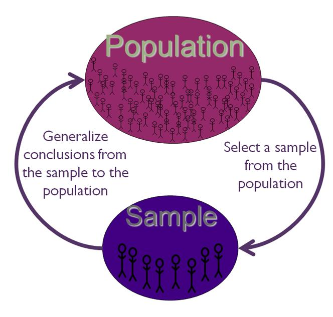
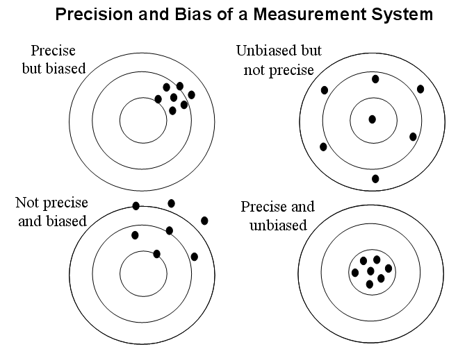
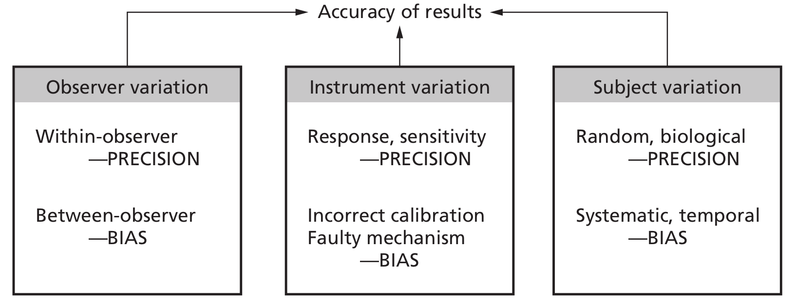
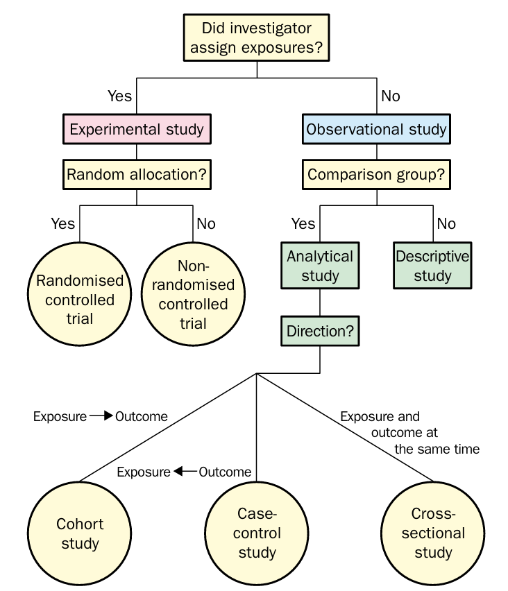
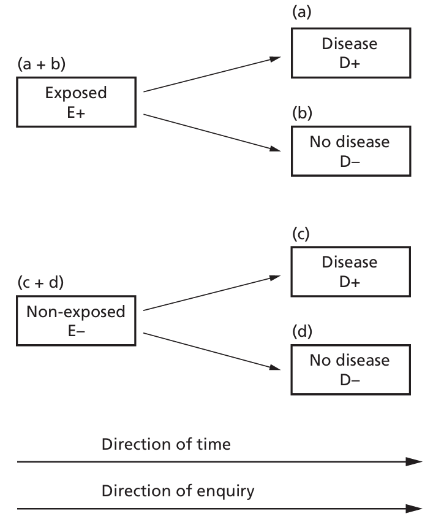
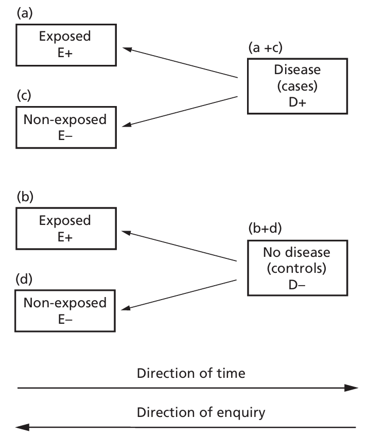
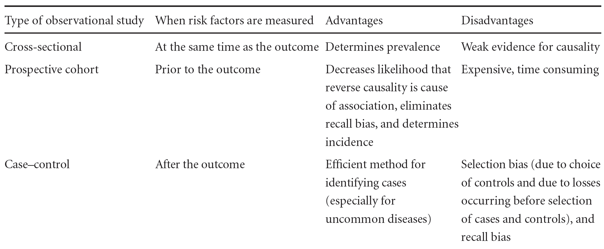

# Clinical research

(Sara Balduzzi, Antonios Daletzakis and Vincent van der Noort)

## Clinical research, why and how


Time to take a step back. What are we doing here all day, as researchers? What is our goal and why is everything so complicated?

Of course there are many answers to these questions but one important aspect is this:

Clinical research tries to answer a question about *a large group of patients* (e. g. all stage III non-small cell lung cancer patients) by looking at a *small subset of these patients* (the patients in the trial).

<center></center>


You collect a number of study participants, see (for instance) how well they react to a new drug and then draw conclusions about how all other patients with the same disease will react to this drug in the future.

The first thing that comes to mind when seeing this is: this is impossible. You cannot know everything about all the people that are *not* in the trial. This is correct, on a fundamental level what we want is impossible and it is important to realize that statistics cannot change that: statistics is not magic.

However, more important is to *not give up*. As researchers we take (what I think is) the best course of action when confronted with an impossible situation: make the best of it. In our case: try to do what we can to make the conclusions about the large group of people (the general population) based on the small set of people (the study population) *as reliable as possible*. This what statistics, but also (part of) the rules and regulations from GCP are all about. While it is true that we cannot know everything, it is also true that after doing a study we know *more* than we knew before.


### Bias and Precision

Much of the measures we take to draw more reliable conclusions fall in three categories:

- Increase accuracy
- Decrease bias
- Make sure your trial measures the things you are actually interested in in clinical practice

What do these terms mean and what can we do about it?

The **precision** of a quantitative measurement relates to the amount of random variation about a fixed point (be it the true value or not).


**Bias** may be defined as any factor or process that tends to produce results or conclusions that differ systematically from the truth. Any research study in a medical field is open to bias (from many sources).


In general, an accurate measurement is defined as both **unbiased and precise**.

<center></center>

**Group discussion**: the following picture gives some rather abstract examples of things that can affect the accuracy of our measurements, let's see if we can give concrete examples on all of them:

```{r sources-variation, echo=FALSE, fig.cap="Sources of variation", out.width="80%",, fig.align="center"}

```

### Increase accuracy

Some general strategies for increasing accuracy are:

- Increase the sample size
- Use more accurate or sensitive techniques for your measurements
- Take prognostic factors into account

We will discuss all three of them shortly.

**Sample size** There is an obvious intuitive reason why increasing the sample size is good: we are trying to learn something about a large group of patients. The larger the fraction of those patients we actually see in our study, the more we learn about them.

But there is also a more mathematical reason, sometime called the law of large numbers. Suppose we are will to accept that (for now) we cannot learn enough about our patients to predict for each future patient their exact time of death or even whether or not their tumor will respond to drug X. However we do believe that by doing the study we can get some useful 'summary' level information about the patient group as a whole: what is their *median* overall survival? What *fraction* of patients will respond to drug X?

The median survival in the study patients is a an estimate of this 'true' median survival in all patient; the observed response rate in the study patients is an estimate of the 'true' response rate in all patients - this latter number can be interpreted as the probability for in individual future patient to respond.

Now this estimate will likely not be 100% accurate (i.e. equal to the true value) because of inter-subject variation and the fact that not every patient in past, present and future participates in the trial. But here we know that the more patients we include the more accurate the estimate becomes, and we can also calculate how fast. This is no longer a matter of biology but of mathematics: we can just model the trial patients as marbles we randomly draw from the urn of all patients.

(Note that here it is important the study patients are indeed a representative sample of the population of interest!)

We have an exercise about this further down. First let's look at the other two bullets.

**Sensitive measurements** Our hospital is named after Antoni van Leeuwenhoek who contributed tremendously to our understanding of biology by improving the sensitivity of an (existing) measurement apparatus: the microscope. Just to say that there really *is* fame and glamour in this boring sounding bullet point.

In the context of clinical trials this is more about using standardized questionnaires for patient reported outcomes, standardized measurements of tumor (e.g. Recist), finding ways to be even better than that, like the automatic volume measurements that are currently developed here in the AvL, using overall survival instead of progression free survival as a measure of survival etc.

**Prognostic factors** Imagine that you are trying to estimate the *difference* in survival between two groups of patients (e.g. smokers and non-smokers) but among your trial patients you see that the groups do not only differ only in smoking status but also in other known prognostic factors such as age, socioeconomic status, percentage females etc. Then in order to get a more accurate of what part of the difference is attributable to smoking we can make a *regression model* taking these other factors into account. You already had a whole chapter on regression models, so this is just a short reminder why we care.

### Reducing bias: randomized trials

The last example with smokers and non-smokers that differ in various aspects also ties in with the question of how to reduce bias. We can make a very long list (e.g. Chavalarias \textit{et.al.} J Clin Epidemiology 63 (2010) identify 235 types of bias that have accquired their own name throughout the literature) but here I want to list just a few thing common in clinical trials:

- Identify sources of bias
- Use a control group
- Randomisation
- Blinding

The first point is obvious: **think about everything that can go wrong before starting your trial**.

**Control groups:** If you give a number of study patients drug X and after 1 year all of them are still alive, this looks like as if drug X is working very well, especially if you are someone who already believed that. But how do we know that these patients wouldn't have lived for one year anyway? 

One solution out of this is to include a second group of patients that do not get drug X but the standard of care and see if people in the 'drug X'-group do actually live longer (or more often make the 1 year mark).

**Randomization:** Can we improve on the idea of the previous paragraph? We saw in the smoker/non-smoker example that it is annoying if the groups you want to compare differ in more aspects than the one you are interested in. Ideally we want the groups to be as comparable as possible with the exception of the one thing we are studying (normally: which treatment do the patients get, but sometimes also a potential risk factor like smoking).

One way to achieve that is through *randomization*. All patients that are eligible and willing to participate are randomly assigned to treatment A or treatment B. The groups will not be exactly equal, but due to the law of large numbers again we assume that when including enough patients all *known and unknown* prognostic factors must be balanced between arms.

When it comes to known factors we can also manipulate the randomness a bit (see chapter stratification later today) to ensure these are balanced.


Randomized controlled trials are considered the gold standard in clinical research

**Question:** What are some reasons to trust 'randomness' more than people when assigning patients to treatment arms?

**Question:** If randomized trials are so great, then why (i.e. for what reasons) do we do so many one-armed trials?


**Blinding:** Sometimes patients and/or treating physicians are *blinded* to (e.g. do not know) which treatment a patient receives with the goal of eliminating the placebo effect (or making it equally bad between arms). Also (even in one-armed trials) treating physicians are blinded to the emerging outcomes in order to prevent influencing their decisions on which patients to include or not into the trial.

In many practical situations blinding is not possible. (E.g. a trial that compares surgery to chemotherapy.) The amount of effort spend on blinding also depends on the outcome (e.g. when the outcome is overall survival we worry less about the placebo effect than when the outcome is (reduction of) pain).


### Exercise: law of large numbers in a one-arm trial.

```{r results="asis", echo=FALSE, comment=""}
catLinkTaskSection("exercises/01-exercise-one-arm-trials.Rmd" );
```

### Short summary of what we found in the exercise

We see:

- **On one hand:** what we want (to figure something out about *all* patients based on *some* patients) is fundamentally impossible. The probability of getting a wrong answer is greater than the probability of getting the right answer
- **On the other hand:** The situation is  not hopeless. By including a not-too-tiny amount of patients we can make the probability of finding a wrong answer that is *clinically relevantly different* from the true answer pretty small.

Of course you have talked about this before already in the chapter about power and sample size.


```{r setup-randomization, include=FALSE}
required_pkgs <- c("randomizr", "blockrand", "carat")
missing_pkgs <- required_pkgs[!vapply(required_pkgs, requireNamespace, logical(1), quietly = TRUE)]

if (length(missing_pkgs) > 0) {
  stop(
    paste0(
      "Please install the following packages before running this chapter: ",
      paste(missing_pkgs, collapse = ", ")
    )
  )
}

imbalance_summary <- function(trt, covariates) {
  tab_trt <- table(trt)
  size_diff <- abs(tab_trt[1] - tab_trt[2])

  cov_diffs <- lapply(names(covariates), function(v) {
    levs <- unique(covariates[[v]])
    s <- sapply(levs, function(lev) {
      abs(sum(trt == names(tab_trt)[1] & covariates[[v]] == lev) -
            sum(trt == names(tab_trt)[2] & covariates[[v]] == lev))
    })
    data.frame(variable = v, level = levs, abs_diff = as.numeric(s))
  })

  list(size_diff = as.numeric(size_diff), cov_diffs = do.call(rbind, cov_diffs))
}

sum_covariate_imbalance <- function(trt, covariates) {
  tmp <- aggregate(abs_diff ~ variable,
                   data = imbalance_summary(trt, covariates)$cov_diffs,
                   sum)
  sum(tmp$abs_diff)
}
```

## Randomization techniques

### Randomization in a randomized clinical trial

A randomized clinical trial compares treatments by allocating patients to treatment groups using chance rather than clinician choice. In a simple two-arm trial the basic structure is:

1. define the study population;
2. randomize eligible patients to treatment `A` or `B`;
3. follow patients in the same way in both groups;
4. compare outcomes between the groups.

The central idea is that treatment groups should be formed in a fair way. If clinicians choose who receives which treatment, one arm may end up with younger patients, milder disease, or patients with better prognosis. Then a difference in outcome could reflect the treatment, but it could also reflect pre-treatment differences between the groups.

### Why randomize?

Randomization helps make treatment groups comparable *on average*. It does not guarantee two identical groups in one particular trial, but it reduces systematic differences in baseline characteristics and helps protect the treatment comparison from selection bias.

In this section we look at three common approaches:

- simple randomization;
- block randomization;
- minimization.

The main code uses package functions, because that is closer to how these methods are implemented in practice. Alongside that, we use small hand-worked examples to explain what each method is doing.

##3 What randomization can and cannot do

Randomization is extremely important, but it is not a magic solution. It helps prevent bias in the treatment allocation process. It does **not** fix problems caused by poor outcome measurement, missing data, lack of blinding, non-adherence, or protocol deviations. A well-randomized trial can still give misleading results if these other issues are not handled carefully.

### Working example

Consider a small two-arm trial in which 24 patients arrive sequentially. Before treatment allocation, three prognostic factors are recorded for each patient: sex, age group, and disease severity.

```{r}
set.seed(1405)
n <- 24
trial.data <- data.frame(
  patient = 1:n,
  sex = factor(sample(c("Female", "Male"), n, replace = TRUE)),
  age = factor(sample(c("Young", "Old"), n, replace = TRUE, prob = c(0.55, 0.45))),
  severity = factor(sample(c("Low", "High"), n, replace = TRUE, prob = c(0.60, 0.40)))
)
head(trial.data, 10)
```

The objective is to allocate each patient to treatment `A` or `B`.

### Simple randomization

In simple randomization, each patient is assigned independently, with the same probability of going to either treatment arm. In a two-arm trial with equal allocation, each patient has probability 0.5 of receiving treatment `A` and probability 0.5 of receiving treatment `B`.

This is the easiest randomization technique to understand and to implement. However, in a small trial it can lead to imbalance in the number of patients per group, and it can also lead to accidental imbalance in important prognostic factors.

#### A first look

```{r}
set.seed(11)
sample(c("A", "B"), size = 12, replace = TRUE)
```

This is already a simple randomization list for 12 patients. Because assignments are independent, there is no guarantee that the final numbers in the two groups will be equal.

#### Working example

The package function `randomizr::simple_ra()` performs this kind of assignment directly.

```{r}
set.seed(21)
trt.simple <- randomizr::simple_ra(
  N = n,
  conditions = c("A", "B")
)

trial.simple <- cbind(trial.data, treatment = trt.simple)
head(trial.simple, 10)

table(trial.simple$treatment)
```

A useful first check is the difference in the number of patients allocated to each treatment.

```{r}
abs(sum(trt.simple == "A") - sum(trt.simple == "B"))
```

Because patients are randomized one by one, the imbalance can change during recruitment. We can display the running difference between the cumulative numbers in arms `A` and `B`.

```{r}
running.diff.simple <- cumsum(trt.simple == "A") - cumsum(trt.simple == "B")
plot(running.diff.simple, type = "s", col = "blue",
     xlab = "Patient order", ylab = "Running difference (A - B)",
     main = "Simple randomization")
abline(h = 0, lty = 2)
```

Simple randomization is especially problematic in small studies. To see this, we simulate many small trials with `n = 20` patients and compute the final absolute imbalance `|n_A - n_B|`.

```{r}
set.seed(31)
nsim <- 2000
n.small <- 20
imb.simple <- replicate(nsim, {
  trt <- randomizr::simple_ra(N = n.small, conditions = c("A", "B"))
  abs(sum(trt == "A") - sum(trt == "B"))
})

hist(imb.simple, col = "blue", main = "Simple randomization",
     xlab = "|nA - nB|")
mean(imb.simple >= 6)
```

The last value estimates the probability that the final imbalance is at least 6 patients in a study of size 20.

```{r results="asis", echo=FALSE, comment=""}
catLinkTaskSection("exercises/02-Simple-randomization-packages.Rmd" );
```

### Block randomization

In block randomization, the randomization list is built in blocks. Within each block, the numbers allocated to each treatment are fixed in advance. For example, with block size 4 and allocation ratio 1:1, each block contains two `A` labels and two `B` labels, in random order.

The main advantage is that the numbers in the two treatment groups remain close to each other throughout recruitment. This is particularly useful in small or medium-sized trials.

#### A block of size 4

```{r}
set.seed(14)
sample(c("A", "A", "B", "B"))
```

This is a single balanced block. The order is random, but the block always contains two `A` allocations and two `B` allocations.

#### Working example

The package `blockrand` generates treatment lists block by block. In a two-arm trial, `block.sizes = 2` corresponds to an actual block size of 4, because the package multiplies by the number of treatment groups.

```{r}
set.seed(21)
br.fixed <- blockrand::blockrand(
  n = n,
  levels = c("A", "B"),
  block.sizes = c(2)
)

trt.block <- br.fixed$treatment[seq_len(n)]
trial.block <- cbind(trial.data, treatment = trt.block)

head(br.fixed)
table(trial.block$treatment)
abs(sum(trt.block == "A") - sum(trt.block == "B"))
```

Now we compare the running imbalance under simple randomization and block randomization.

```{r, fig.width = 10, fig.height = 4}
par(mfrow = c(1, 2))
plot(running.diff.simple, type = "s", col = "blue",
     xlab = "Patient order", ylab = "Running difference (A - B)",
     main = "Simple randomization")
abline(h = 0, lty = 2)

running.diff.block <- cumsum(trt.block == "A") - cumsum(trt.block == "B")
plot(running.diff.block, type = "s", col = "blue",
     xlab = "Patient order", ylab = "Running difference (A - B)",
     main = "Block randomization")
abline(h = 0, lty = 2)
```

With block randomization the curve returns regularly towards 0, because balance is forced at the end of each block.

A drawback is that if the block size is known, the last allocations in a block may become predictable. One way to reduce predictability is to use random block sizes.

```{r}
set.seed(21)
br.random <- blockrand::blockrand(
  n = n,
  levels = c("A", "B"),
  block.sizes = c(2, 3)
)

trt.block.random <- br.random$treatment[seq_len(n)]
table(trt.block.random)
```

Another extension is *stratified block randomization*. In that case, separate block randomization lists are used within strata defined by important variables, for example sex or disease stage.

```{r}
set.seed(8)
trt.strat <- rep(NA_character_, n)

for (lev in levels(trial.data$sex)) {
  idx <- which(trial.data$sex == lev)
  tmp <- blockrand::blockrand(
    n = length(idx),
    levels = c("A", "B"),
    block.sizes = c(2),
    stratum = lev
  )
  trt.strat[idx] <- as.character(tmp$treatment[seq_along(idx)])
}

table(trt.strat, trial.data$sex)
```

This helps keep treatment counts balanced inside each stratum. In practice, only a few important stratification variables can be handled this way, because the number of strata grows quickly.

```{r results="asis", echo=FALSE, comment=""}
catLinkTaskSection("exercises/03-Block-randomization-packages.Rmd" );
```

### Minimization


Simple and block randomization mainly aim to control the number of patients per treatment arm. In some studies, it is also important to keep several prognostic factors balanced between groups. Minimization is an adaptive allocation method designed for that purpose.

When a new patient enters the study, we compare the imbalance that would result from assigning the patient to treatment 1 with the imbalance that would result from assigning the patient to treatment 2. The preferred treatment is the one that gives the smaller imbalance score.

#### The basic idea

For each incoming patient, the minimization rule works as follows:

1. look at the patient's covariates;
2. calculate the imbalance score if the patient is assigned to treatment 1;
3. calculate the imbalance score if the patient is assigned to treatment 2;
4. prefer the treatment with the smaller score;
5. keep a random element, so that the preferred treatment is chosen with high probability rather than certainty.

#### A hand-worked example

Suppose the next patient is:

- Female
- Old
- High severity

and suppose the allocations among the first 8 patients have produced the following counts for these levels:

```{r}
mini.example <- data.frame(
  variable = c("Sex", "Age", "Severity"),
  level = c("Female", "Old", "High"),
  count_A = c(3, 2, 1),
  count_B = c(2, 3, 3)
)
mini.example
```

If we assign this patient to treatment `A`, the absolute differences for the three matching levels become:

- Female: `|4 - 2| = 2`
- Old: `|3 - 3| = 0`
- High: `|2 - 3| = 1`

With equal weights, the Pocock-Simon score is proportional to:

\[
\frac{1}{3}(2^2 + 0^2 + 1^2) = \frac{5}{3}.
\]

If we assign this patient to treatment `B`, the absolute differences become:

- Female: `|3 - 3| = 0`
- Old: `|2 - 4| = 2`
- High: `|1 - 4| = 3`

and the corresponding score is:

\[
\frac{1}{3}(0^2 + 2^2 + 3^2) = \frac{13}{3}.
\]

So treatment `A` is preferred because it gives the smaller imbalance score.

#### Working example

The package function `carat::PocSimMIN()` implements Pocock and Simon's minimization procedure. The returned assignments are coded as `1` and `2`, so we relabel them as `A` and `B`.

```{r}
set.seed(21)
res.min <- carat::PocSimMIN(
  data = trial.data[, c("sex", "age", "severity")],
  p = 0.80
)

trt.min <- res.min$assignments
trial.min <- cbind(trial.data, treatment = trt.min)

table(trial.min$treatment)
```

We now compare simple randomization and minimization with respect to covariate balance.

```{r}
imb.simple.tab <- aggregate(abs_diff ~ variable,
                            data = imbalance_summary(trt.simple,
                                                     trial.data[, c("sex", "age", "severity")])$cov_diffs,
                            sum)
imb.min.tab <- aggregate(abs_diff ~ variable,
                         data = imbalance_summary(trt.min,
                                                  trial.data[, c("sex", "age", "severity")])$cov_diffs,
                         sum)

imb.simple.tab
imb.min.tab
```

A smaller value means better balance between the two groups for that variable.

We can also compare both methods over many simulated trials.

```{r}
set.seed(52)
nsim <- 500
res.cov <- replicate(nsim, {
  covariates <- data.frame(
    sex = factor(sample(c("Female", "Male"), n, replace = TRUE)),
    age = factor(sample(c("Young", "Old"), n, replace = TRUE, prob = c(0.55, 0.45))),
    severity = factor(sample(c("Low", "High"), n, replace = TRUE, prob = c(0.60, 0.40)))
  )

  trt.s <- randomizr::simple_ra(N = n, conditions = c("A", "B"))
  trt.m.obj <- carat::PocSimMIN(data = covariates, p = 0.80)
  trt.m <- trt.m.obj$assignments

  c(simple = sum_covariate_imbalance(trt.s, covariates),
    minimization = sum_covariate_imbalance(trt.m, covariates))
})

boxplot(as.numeric(res.cov["simple", ]), as.numeric(res.cov["minimization", ]),
        names = c("Simple", "Minimization"), col = "blue",
        ylab = "Total covariate imbalance")
```

Typically, minimization gives lower covariate imbalance than simple randomization. The price to pay is that the allocation rule is more complicated, and if the random component is too small, the next treatment assignment may become too predictable.

```{r results="asis", echo=FALSE, comment=""}
catLinkTaskSection("exercises/04-Minimization-packages.Rmd" );
```

### Summary

The three approaches in this section solve different problems:

- simple randomization is easy and fully random, but may give noticeable imbalance in small studies;
- block randomization keeps treatment counts close throughout recruitment, but fixed blocks may reduce unpredictability;
- minimization improves balance on important prognostic factors, but the procedure is more complex and should keep a random component.

The main lesson is that better balance often requires more structure. At the same time, more structure can make the next allocation easier to guess. In practice, the choice of randomization method depends on study size, the importance of prognostic factors, and the need to protect allocation concealment.


## Observational studies


<center></center>


### Why do we need observational studies?

Randomized controlled trials are often the best design for studying causal effects, but they are not always possible. In many real settings, randomization is not ethical, not practical, or too expensive. In addition, patients enrolled in randomized trials are often more selected than the patients seen in routine care, so trial results may not generalize perfectly to the target population.

For these reasons, observational studies remain essential in medical research. In an observational study, the researcher does **not** assign the exposure. Instead, the exposure and the outcome are observed as they occur in practice.

The main strength of randomized trials is that randomization makes causal interpretation easier. But observational designs are needed whenever an exposure cannot realistically or ethically be assigned.

In this section we look at three common observational designs:

- cross-sectional studies;
- cohort studies;
- case-control studies.

### Classifying observational studies

A useful way to distinguish the three designs is by asking **when** exposure and outcome are assessed.

- In a **cross-sectional study**, exposure and outcome are measured at the same moment.
- In a **cohort study**, we start from exposure status and follow people forward to see who develops the outcome.
- In a **case-control study**, we start from outcome status and then look backward for prior exposure.

A short memory aid is:

- cross-sectional = snapshot;
- cohort = from exposure to outcome;
- case-control = from outcome back to exposure.


### Cross-sectional studies

A cross-sectional study gives a snapshot of a population at one point in time. Its main use is to estimate **prevalence**, that is, the proportion of individuals in the population who currently have a disease or condition.

Its main limitation is that exposure and outcome are observed at the same time. So if an association is found, we usually cannot tell whether the exposure caused the outcome or whether the outcome influenced the exposure.

Cross-sectional studies are therefore useful for describing how common a condition is, but they are much weaker for causal interpretation.

#### Working example

Suppose that 300 adults are surveyed during a clinic visit, and both obesity status and arthritis status are recorded at that same visit.

```{r}
cross.tab <- matrix(
  c(36, 84,
    24, 156),
  nrow = 2,
  byrow = TRUE,
  dimnames = list(
    Obesity = c("Yes", "No"),
    Arthritis = c("Yes", "No")
  )
)

cross.tab
```

The overall prevalence of arthritis is:

```{r}
prev.arthritis <- sum(cross.tab[, "Yes"]) / sum(cross.tab)
prev.arthritis
```

So in this cross-sectional sample, the prevalence of arthritis is 20%.

We can also compare the prevalence of arthritis between obese and non-obese individuals.

```{r}
prop.table(cross.tab, margin = 1)
```

The obese group has a higher prevalence of arthritis in this snapshot. But this does **not** establish a causal direction. A cross-sectional study cannot answer whether obesity increased the risk of arthritis, whether arthritis reduced physical activity and increased obesity, or whether both are related to other factors.

Another important limitation is that cross-sectional studies estimate **prevalence**, not **incidence**. They describe how much disease is present at a given time, not how often new disease occurs over time.

### Cohort studies

Let's consider a standard 2 \(\times\) 2 table

\[
\begin{array}{c|cc}
 & \text{Disease Yes} & \text{Disease No} \\
\hline
\text{Exposure Yes} & a & b \\
\text{Exposure No} & c & d
\end{array}
\]


A cohort study starts with exposure status and follows individuals forward in time to observe whether the outcome occurs. Because the outcome happens after exposure assessment, this design is more natural than a cross-sectional study for studying incidence and risk.

<center></center>

Important strengths of cohort studies are:

- incidence can be estimated;
- several outcomes can be studied for the same exposure;
- exposures that cannot be randomized can still be studied;
- external validity is often higher than in a highly selected randomized trial.

Important limitations are:

- confounding and selection bias are still concerns;
- causal interpretation requires strong assumptions;
- long follow-up may be expensive and time-consuming.

In a randomized trial, randomization helps make treated and untreated groups comparable. In a cohort study, there is no such protection. Any causal interpretation therefore depends on correctly adjusting for systematic differences between exposed and unexposed individuals.

This is difficult in practice, because it requires both:

- a reasonable causal model;
- measurement of all important variables that need adjustment.

So cohort studies provide valuable information, but they must be designed and interpreted with care.

#### Working example

Consider a cohort of 200 individuals followed for a fixed period. At baseline, 100 are exposed and 100 are unexposed. During follow-up, disease occurs in 40 exposed individuals and 10 unexposed individuals.

```{r}
cohort.tab <- matrix(
  c(40, 60,
    10, 90),
  nrow = 2,
  byrow = TRUE,
  dimnames = list(
    Exposure = c("Yes", "No"),
    Disease = c("Yes", "No")
  )
)

cohort.tab
```

The risk of disease in each group is:

```{r}
risk.exposed <- cohort.tab["Yes", "Yes"] / sum(cohort.tab["Yes", ])
risk.unexposed <- cohort.tab["No", "Yes"] / sum(cohort.tab["No", ])

risk.exposed
risk.unexposed
```

The relative risk (or risk ratio) is therefore:

```{r}
rr.cohort <- ( cohort.tab["Yes", "Yes"] / sum(cohort.tab["Yes", ]) )/ (cohort.tab["No", "Yes"] / sum(cohort.tab["No", ]))
rr.cohort
```

So the disease risk is 4 times as high in the exposed group as in the unexposed group.

Because this is a cohort design, these risks are meaningful: the denominators come from the numbers at risk in the exposed and unexposed groups.

### Case-control studies

A case-control study starts with the outcome. We first identify **cases** with the disease and **controls** without the disease, and then compare how common previous exposure was in the two groups.


<center></center>

This design is especially useful for rare diseases, because it would be inefficient to wait for rare cases to appear in a prospective cohort.

Case-control studies also require careful sampling.

- Cases should have a clearly defined disease or outcome.
- Controls should come from the same source population that gave rise to the cases.
- Control selection should not depend on the exposure of interest.

This last point is very important. For example, if the exposure is smoking, choosing partners or siblings of lung cancer cases as controls may be problematic because their smoking behavior may be more similar than in the general source population. Likewise, choosing controls with another disease related to the same exposure can also bias the comparison.

Other important limitations are:

- recall bias may affect how past exposure is reported;
- confounding and selection bias remain major concerns;
- matching can make groups more comparable, but it does not automatically remove all bias.

#### Why the relative risk cannot be estimated directly


In a case-control study, the investigator fixes how many cases and controls are sampled. That means the proportion with disease in the sample is determined by the study design, not by the underlying disease risk in the population.

So the usual cohort quantity

\[
\text{relative risk} = \frac{a / (a+b)}{c / (c+d)}
\]

is not meaningful in a case-control sample.

#### Odds and the odds ratio

The appropriate association measure in a case-control study is usually the **odds ratio**.

Recall that odds are defined as

\[
\text{odds} = \frac{P(\text{event})}{1 - P(\text{event})}.
\]

For example, the probability of rolling a 6 with a fair die is \(1/6\), while the odds of rolling a 6 are \(1/5\), because there is 1 favorable side and 5 unfavorable sides.

The odds ratio is

\[
\text{odds ratio} = \frac{a/b}{c/d} = \frac{ad}{bc}.
\]

#### Working example

Suppose the same disease was originally studied in a cohort, but we now perform a case-control study by taking all 50 diseased individuals and a sample of 50 controls. The observed table becomes:

```{r}
casecontrol.tab <- matrix(
  c(40, 20,
    10, 30),
  nrow = 2,
  byrow = TRUE,
  dimnames = list(
    Exposure = c("Yes", "No"),
    Disease = c("Yes", "No")
  )
)

casecontrol.tab
```

The appropriate association measure is the **odds ratio**:

```{r}
or.casecontrol <- (casecontrol.tab["Yes","Yes"]*casecontrol.tab["No","No"])/(casecontrol.tab["Yes","No"]*casecontrol.tab["No","Yes"])
or.casecontrol
```

So the odds ratio is 6.

This is **not** the same as the cohort relative risk of 4. The odds ratio and relative risk are different quantities.

### Rare disease approximation

When the disease is rare, the odds ratio from a case-control study is often close to the relative risk from the full cohort.

For example, suppose the cohort table is:

```{r}
rare.cohort <- matrix(
  c(4, 60,
    1, 90),
  nrow = 2,
  byrow = TRUE,
  dimnames = list(
    Exposure = c("Yes", "No"),
    Disease = c("Yes", "No")
  )
)

rare.cohort
```

The corresponding relative risk is:

```{r}
rr.rare <- ( rare.cohort["Yes", "Yes"] / sum(rare.cohort["Yes", ]) )/ (rare.cohort["No", "Yes"] / sum(rare.cohort["No", ]))
rr.rare
```

Now suppose a case-control sample produces:

```{r}
rare.cc <- matrix(
  c(4, 20,
    1, 30),
  nrow = 2,
  byrow = TRUE,
  dimnames = list(
    Exposure = c("Yes", "No"),
    Disease = c("Yes", "No")
  )
)

rare.cc
```

Its odds ratio is:

```{r}
or.rare <- (rare.cc["Yes","Yes"]*rare.cc["No","No"])/(rare.cc["Yes","No"]*rare.cc["No","Yes"])
or.rare
```

Here the relative risk is about 5.69 and the odds ratio is 6, so they are close. This is the usual rare-disease approximation.

```{r results="asis", echo=FALSE, comment=""}
catLinkTaskSection("exercises/05-Observational-designs-packages.Rmd" )
```

### Summary

The main ideas of this section are:

- cross-sectional studies are useful for prevalence, but weak for causal interpretation;
- cohort studies allow direct estimation of incidence and relative risks;
- case-control studies are efficient for rare diseases and usually rely on the odds ratio;
- in case-control studies, controls must represent the same source population as the cases;
- when the disease is rare, the odds ratio often approximates the relative risk.

In practice, the question we want to answer determines the choice of the study design and of the measure of association.


<center></center>


